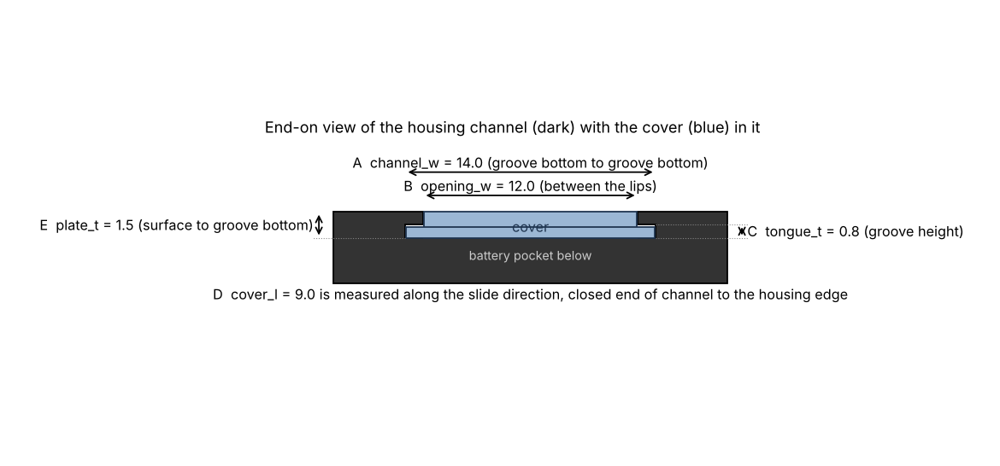

# Caliper battery cover

Replacement slide-on battery cover for a Neiko 01407A style 6" digital caliper
(LR44 / SR44 cell, black housing with mm / inch/F and OFF ON ZERO buttons).
The same housing is sold as Harbor Freight "Pittsburgh", Clockwise Tools,
VINCA and many unbranded calipers, so the cover should fit those too.

The original cover is a flat plastic plate with a thin tongue along each long
edge. The tongues ride in two grooves in the housing, and the plate slides in
from the beam end toward the display. To remove it you push it away from the
display with your thumb.

Files:

| File | What it is |
| --- | --- |
| `caliper_battery_cover.scad` | Editable OpenSCAD source. All dimensions are parameters at the top. |
| `cover.stl` | The cover at the default dimensions below. |
| `fit_test.stl` | Three 6 mm long coupons, 0.5 mm narrower, nominal and 0.5 mm wider, marked with 1, 2 and 3 notches. |
| `build.py` | Rebuilds the STLs and the pictures without OpenSCAD (needs `pip install trimesh manifold3d numpy matplotlib`). |
| `cross_section.png` | Picture of the five measurements. |
| `preview_cover.png` | Render of the cover. |

## Default dimensions

B and D were measured on the caliper. The rest are still estimates. The two
snap bumps at the open end match the two dimples in the housing, about 1.5 mm
in from the side edges and from the opening.

| Letter | Parameter | Default | What to measure |
| --- | --- | --- | --- |
| A | `channel_w` | 14.0 mm | Width of the channel from the bottom of one groove to the bottom of the other. Set through `lip_w` (1.0 mm per side, estimated). Hardest one to see, so use the fit test coupons. |
| B | `opening_w` | 12.0 mm | Visible opening between the two lips, measured at the housing surface. Measured. |
| C | `tongue_t` | 0.8 mm | Height of the groove. A feeler gauge or the depth rod works. |
| D | `cover_l` | 9.0 mm | Along the slide direction, from the closed end of the channel to the edge of the housing. Measured. The cover is wider than it is long. |
| E | `plate_t` | 1.5 mm | From the housing surface down to the bottom of the groove. |



## Suggested order

1. Print `fit_test.stl`. Slide each coupon into the channel from the beam end.
   The coupon that is snug but moves without force gives you `channel_w`
   (1 notch = 13.5, 2 notches = 14.0, 3 notches = 14.5). If none fits, change
   `lip_w` and rebuild.
2. Measure B, C, D and E and set them in the `.scad` file, or pass them to
   `build.py`:

   ```
   python3 build.py --opening-w 12 --lip-w 1.0 --cover-l 9 --plate-t 1.5 --tongue-t 0.8
   ```

3. Print `cover.stl`.

The underside is one flat plane: the centre of the cover and the tongues share
the same bottom face, so the cover presses the cell down to the level of the
grooves. The thicker centre section stands up between the lips, flush with the
housing surface.

Optional features in the `.scad` file:

- `detent_d`, `detent_x`, `detent_inset`: the two snap bumps under the open end (on by default, 1.2 mm wide, 0.3 mm proud). Set `detent_d = 0` to remove them.
- `battery_pad_h`: a pad on the underside that presses the cell against its contact if the cell sits loose.
- `end_lip_h`: a downward lip at the open end that closes off the housing opening.

The `clearance` parameter (0.15 mm) is subtracted from the width and the tongue
height. Raise it if the part binds, lower it if it rattles.

## Printing

- PETG or PLA, 0.12 to 0.16 mm layers, 0.4 mm nozzle, 100 % infill (the part is tiny).
- Print flat, underside on the bed. The tongues and the lead-in chamfer need no support.
- If the first layer squishes out and makes the tongues too wide, sand the long edges or raise `clearance`.

## Existing designs online

None of these were confirmed against this exact caliper, and the sites block
automated access, so open them yourself. The Harbor Freight Pittsburgh 6"
covers are the closest, since it is the same housing.

- [Pittsburgh Caliper (Harbor Freight) Battery Cover](https://thangs.com/m/495971) by Thrifty_Tech_Nerd, originally [Thingiverse 5157460](https://www.thingiverse.com/thing:5157460). Restricted license.
- [Harbor Freight Caliper Battery Cover, detailed version](https://www.printables.com/model/681235-harbor-freight-caliper-battery-cover-detailed-vers) on Printables.
- [Calipers Battery Cover](https://www.printables.com/model/110078-calipers-battery-cover) on Printables, includes an editable Fusion 360 file.
- [Battery cover for SR44 caliper](https://3dgo.app/models/printables/1109396), lid 15.2 mm wide and about 20 mm long, made for a 300 mm caliper.
- [Geoff's Digital Caliper Battery Cover](https://www.thingiverse.com/thing:1130777), an older generic design others have started from.
- [iFixit battery replacement guide](https://www.ifixit.com/Guide/Digital+Calipers+Battery+Replacement/158650) shows how the cover slides.

Neiko has also been reported to mail a free replacement cover when emailed
about a lost one, which is worth a try in parallel.
